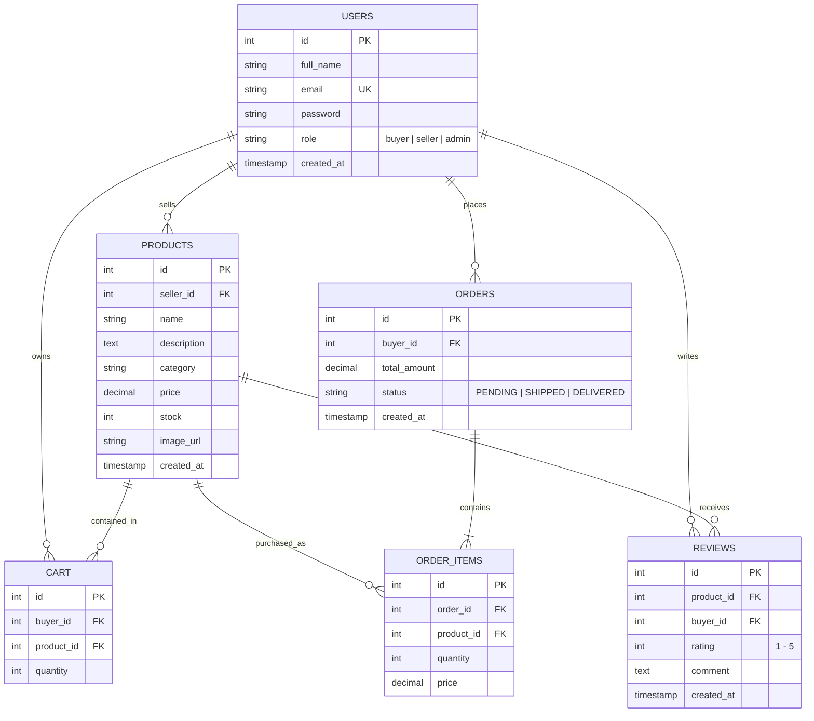
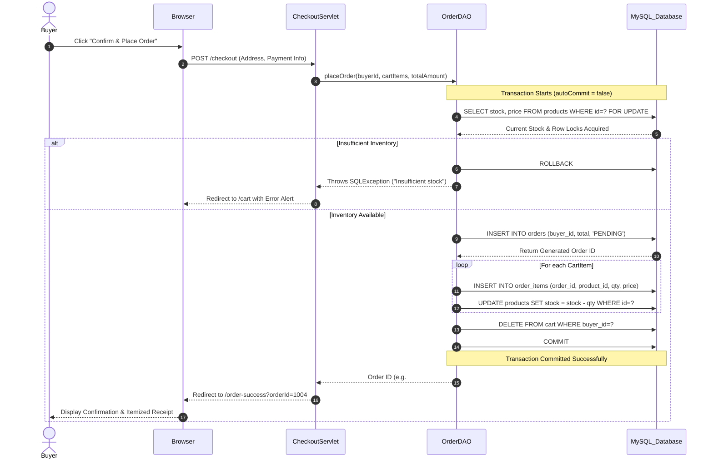

# SmartShop E-Commerce System

> **Enterprise Capstone Web Application**  
> Built with **Jakarta EE (Servlet 6.0, JSP 3.1, JSTL 3.0)**, **Apache Tomcat 10+**, **MySQL 8.0**, and **Bootstrap 5**.

---

## 📋 Table of Contents
1. [Project Overview & Architecture](#project-overview--architecture)
2. [Technology Stack](#technology-stack)
3. [Directory Layout](#directory-layout)
4. [Pre-Seeded Demo Credentials](#pre-seeded-demo-credentials)
5. [Database Setup (`schema.sql`)](#database-setup)
6. [Local Build & Tomcat Deployment](#local-build--tomcat-deployment)
7. [System Diagrams (Mermaid.js)](#system-diagrams)
   - [Entity-Relationship (ER) Diagram](#1-entity-relationship-er-diagram)
   - [Role Use Case Diagram](#2-role-use-case-diagram)
   - [ACID Checkout Sequence Diagram](#3-acid-checkout-sequence-diagram)
8. [Security & Architectural Best Practices](#security--architectural-best-practices)
9. [Automated Testing](#automated-testing)
10. [Production Deployment Guide](#production-deployment-guide)

---

## 🌟 Project Overview & Architecture

**SmartShop** is an enterprise-grade multi-vendor e-commerce platform designed for production readiness. It implements a clean **Model-View-Controller (MVC)** and **Data Access Object (DAO)** pattern, separating business logic, database transactions, and presentation concerns.

### Core Modules:
- **Authentication & Authorization**: Role-Based Access Control (RBAC) supporting `buyer`, `seller`, and `admin` roles with BCrypt salt hashing.
- **Dynamic Catalog & Search**: Parametric filtering by category, search query keywords, and price ranges with sort order flexibility.
- **Shopping Cart & Checkout**: Real-time cart calculations, stock-locking transactions (`SELECT ... FOR UPDATE`), item snapshot recording, and inventory decrementing.
- **Seller Hub**: Catalog management (CRUD), low-stock alerting, and store performance tracking.
- **Admin Control Center**: Platform analytics (revenue, order counts, user demographics) and listing moderation.
- **Ratings & Reviews**: Verified purchase gating allowing customers who ordered items to post ratings (1–5 stars) and comments.
- **AI Chatbot Assistant**: Embedded frontend floating widget backed by `/api/chatbot` offering contextual order tracking, smart product recommendations, return policies, and instant answers.

---

## 🛠 Technology Stack

| Layer | Technologies |
|---|---|
| **Backend / Server** | Java 17+, Jakarta EE (Servlet API 6.0, JSP 3.1, JSTL 3.0) |
| **Web Container** | Apache Tomcat 10.1+ (Jakarta EE 10 namespace) |
| **Persistence / DB** | MySQL 8.0+, JDBC Driver 8.3+, Connection Pool Manager |
| **Security / Crypto** | BCrypt (`org.mindrot:jbcrypt`), PreparedStatements, UTF-8 XSS Sanitizer |
| **Frontend UI** | HTML5, CSS3, JavaScript (ES6+), Bootstrap 5.3, Bootstrap Icons, Font Awesome |
| **JSON Serialization** | Google Gson 2.10 |
| **Build & Test** | Apache Maven 3.9+, JUnit 4.13 |

---

## 📁 Directory Layout

```text
smartshop/
├── pom.xml                                   # Maven dependencies & build configuration
├── schema.sql                                # Complete database DDL & realistic seed dataset
├── README.md                                 # Technical documentation & architectural diagrams
├── .gitignore                                # Git ignore rules
├── src/
│   ├── main/
│   │   ├── java/com/smartshop/
│   │   │   ├── config/
│   │   │   │   └── DBConnection.java         # JDBC Connection manager & resource cleanup
│   │   │   ├── model/
│   │   │   │   ├── User.java                 # User entity (buyer/seller/admin)
│   │   │   │   ├── Product.java              # Catalog product entity
│   │   │   │   ├── CartItem.java             # Shopping cart item entity
│   │   │   │   ├── Order.java                # Order header entity
│   │   │   │   ├── OrderItem.java            # Order detail line entity
│   │   │   │   └── Review.java               # Customer review & rating entity
│   │   │   ├── dao/
│   │   │   │   ├── UserDAO.java              # User database operations
│   │   │   │   ├── ProductDAO.java           # Product queries & parametric filtering
│   │   │   │   ├── CartDAO.java              # Cart mutations & subtotal computations
│   │   │   │   ├── OrderDAO.java             # Transactional checkout & order history
│   │   │   │   └── ReviewDAO.java            # Verified reviews & average star ratings
│   │   │   ├── controller/
│   │   │   │   ├── HomeServlet.java          # Landing page & featured spotlight
│   │   │   │   ├── ProductServlet.java       # Product search & filtering
│   │   │   │   ├── ProductDetailServlet.java # Product specifications & reviews
│   │   │   │   ├── LoginServlet.java         # Authentication & role redirection
│   │   │   │   ├── RegisterServlet.java      # User registration
│   │   │   │   ├── LogoutServlet.java        # Session termination
│   │   │   │   ├── CartServlet.java          # Cart operations (add/update/delete)
│   │   │   │   ├── CheckoutServlet.java      # Order processing & confirmation
│   │   │   │   ├── OrderHistoryServlet.java  # Buyer past orders view
│   │   │   │   ├── SellerDashboardServlet.java# Seller statistics & listings
│   │   │   │   ├── SellerProductServlet.java # Seller listing CRUD
│   │   │   │   ├── AdminDashboardServlet.java # Admin KPI metrics
│   │   │   │   ├── AdminUserServlet.java     # User account management
│   │   │   │   ├── AdminProductServlet.java  # Marketplace moderation
│   │   │   │   ├── AdminOrderServlet.java    # Order status management
│   │   │   │   ├── ReviewServlet.java        # Verified review submissions
│   │   │   │   └── ChatbotServlet.java       # AI NLP assistant JSON endpoint
│   │   │   ├── filter/
│   │   │   │   ├── AuthenticationFilter.java # RBAC route protection
│   │   │   │   └── EncodingFilter.java       # UTF-8 character encoding filter
│   │   │   └── util/
│   │   │       ├── PasswordUtil.java         # BCrypt hashing & password verification
│   │   │       └── ValidationUtil.java       # Input sanitization & validation
│   │   ├── resources/
│   │   │   └── db.properties                 # Database connection parameters
│   │   └── webapp/
│   │       ├── WEB-INF/
│   │       │   ├── web.xml                   # Web application deployment descriptor
│   │       │   └── views/
│   │       │       ├── index.jsp             # Marketplace home page
│   │       │       ├── products.jsp          # Catalog search & filter
│   │       │       ├── product-detail.jsp    # Product showcase & reviews
│   │       │       ├── cart.jsp              # Shopping cart view
│   │       │       ├── checkout.jsp          # Checkout & address form
│   │       │       ├── order-success.jsp     # Order confirmation receipt
│   │       │       ├── order-history.jsp     # Customer orders list
│   │       │       ├── login.jsp             # User login form
│   │       │       ├── register.jsp          # User signup form
│   │       │       ├── includes/             # Reusable JSP components (header, nav, footer, chatbot)
│   │       │       ├── seller/               # Seller views (dashboard, product form)
│   │       │       ├── admin/                # Admin views (dashboard, users, products, orders)
│   │       │       └── error/                # 403, 404, 500 custom error pages
│   │       ├── css/style.css                 # Custom responsive stylesheet
│   │       └── js/                           # main.js & chatbot.js
│   └── test/java/com/smartshop/util/         # Unit test cases
```

---

## 🔑 Pre-Seeded Demo Credentials

All seed accounts share the default password: **`password123`**

| Role | Email Address | Password | Privileges |
|---|---|---|---|
| **Admin** | `admin@smartshop.com` | `password123` | Platform-wide oversight, user roles, catalog moderation |
| **Seller** | `seller.tech@smartshop.com` | `password123` | Manage electronics listings, inspect inventory, view sales |
| **Seller** | `seller.fashion@smartshop.com` | `password123` | Manage fashion apparel listings |
| **Buyer** | `alice@buyer.com` | `password123` | Active shopping cart, placed orders, verified reviews |
| **Buyer** | `bob@buyer.com` | `password123` | Active orders, product reviews |

*(The login screen also features one-click demo login buttons for instant testing.)*

---

## 🗄 Database Setup

1. **Start MySQL Server 8.0+**
2. Execute the provided script `schema.sql`:
   ```bash
   mysql -u root -p < schema.sql
   ```
3. Update connection credentials in `src/main/resources/db.properties` if your MySQL root credentials differ:
   ```properties
   db.driver=com.mysql.cj.jdbc.Driver
   db.url=jdbc:mysql://localhost:3306/smartshop_db?useSSL=false&allowPublicKeyRetrieval=true&serverTimezone=UTC&characterEncoding=UTF-8
   db.username=root
   db.password=your_mysql_password
   ```

---

## 🚀 Local Build & Tomcat Deployment

### Prerequisites:
- Java JDK 17 or 21
- Apache Maven 3.8+
- Apache Tomcat 10.1+

### Step 1: Compile & Package `.war` File
Run Maven in the project root:
```bash
mvn clean package
```
*Output artifact:* `target/smartshop.war`

### Step 2: Deploy to Apache Tomcat 10+
1. Copy `target/smartshop.war` into Tomcat's `webapps/` folder:
   - Windows: `C:\apache-tomcat-10.1.x\webapps\`
   - Linux/macOS: `/opt/tomcat/webapps/`
2. Start Apache Tomcat:
   - Windows: `bin\startup.bat`
   - Linux/macOS: `bin/startup.sh`
3. Access the application in any modern web browser:
   ```text
   http://localhost:8080/smartshop/
   ```

---

## 📊 System Diagrams

### 1. Entity-Relationship (ER) Diagram


---

### 2. Role Use Case Diagram

```mermaid
graph TD
    subgraph Actors
        Buyer((Buyer))
        Seller((Seller))
        Admin((Admin))
    end

    subgraph "Buyer Operations"
        UC1[Browse & Search Catalog]
        UC2[Filter by Category & Price]
        UC3[Manage Shopping Cart]
        UC4[Execute Checkout & Pay]
        UC5[View Order History]
        UC6[Submit Verified Product Review]
        UC7[Interact with AI Chatbot]
    end

    subgraph "Seller Operations"
        UC8[View Inventory Dashboard]
        UC9[Add New Product Listing]
        UC10[Update Product & Stock]
        UC11[Delete Product Listing]
        UC12[View Customer Orders for Seller Items]
    end

    subgraph "Admin Operations"
        UC13[View Financial KPIs & Revenue]
        UC14[Manage User Accounts & Roles]
        UC15[Moderate Catalog Listings]
        UC16[Update Order Fulfillment Status]
    end

    Buyer --> UC1
    Buyer --> UC2
    Buyer --> UC3
    Buyer --> UC4
    Buyer --> UC5
    Buyer --> UC6
    Buyer --> UC7

    Seller --> UC8
    Seller --> UC9
    Seller --> UC10
    Seller --> UC11
    Seller --> UC12

    Admin --> UC13
    Admin --> UC14
    Admin --> UC15
    Admin --> UC16
```


---

### 3. ACID Checkout Sequence Diagram


---

## 🛡 Security & Architectural Best Practices

1. **SQL Injection Prevention**: All queries across `UserDAO`, `ProductDAO`, `CartDAO`, `OrderDAO`, and `ReviewDAO` utilize parameterized `java.sql.PreparedStatement` calls. Zero dynamic string concatenation is permitted in SQL strings.
2. **Password Cryptography**: Passwords are saved as one-way salted hashes using the industry-standard **BCrypt** algorithm (`$2a$10$...`). Plain text passwords never enter storage.
3. **Session Fixation Defense**: Upon successful login, the existing session is invalidated (`session.invalidate()`) and a fresh session is instantiated before attaching authentication tokens.
4. **Cross-Site Scripting (XSS) Sanitization**: Client inputs are sanitized using `ValidationUtil.sanitize()` and escaped via JSTL expression formatting.
5. **Role-Based Access Control (RBAC)**: An automated servlet filter (`AuthenticationFilter`) guards routes:
   - `/cart`, `/checkout`, `/orders`, `/review/*` require active user sessions.
   - `/seller/*` strictly enforces `role='seller'` or `role='admin'`.
   - `/admin/*` strictly enforces `role='admin'`.
6. **ACID Transaction Guarantees**: Stock checking, stock reservation, order creation, and cart cleanup execute under an explicit database transaction with row locks (`FOR UPDATE`) and automatic rollback on failure.

---

## 🧪 Automated Testing

Unit testing is configured via Maven Surefire and JUnit:
```bash
mvn test
```

### Key Test Scenarios:
- `PasswordUtilTest`: Validates hashing entropy, BCrypt prefix validity, verification with matching credentials, and rejection of invalid passwords.
- `ValidationUtilTest`: Validates RFC-compliant email matching, minimum password length enforcement, and HTML script entity encoding to prevent XSS.

---

## 🌐 Production Deployment Guide

For enterprise hosting on AWS EC2, DigitalOcean, or Azure Virtual Machines:
1. **JVM Configuration**: Set memory allocation in Tomcat's `setenv.sh`:
   ```bash
   export CATALINA_OPTS="-Xms1024m -Xmx2048m -XX:+UseG1GC"
   ```
2. **Reverse Proxy (Nginx)**: Configure Nginx to terminate SSL certificates (Let's Encrypt) and proxy port `8080`:
   ```nginx
   server {
       listen 443 ssl http2;
       server_name smartshop.example.com;

       ssl_certificate /etc/letsencrypt/live/smartshop/fullchain.pem;
       ssl_certificate_key /etc/letsencrypt/live/smartshop/privkey.pem;

       location / {
           proxy_pass http://127.0.0.1:8080/smartshop/;
           proxy_set_header Host $host;
           proxy_set_header X-Real-IP $remote_addr;
           proxy_set_header X-Forwarded-For $proxy_add_x_forwarded_for;
           proxy_set_header X-Forwarded-Proto https;
       }
   }
   ```
3. **Environment Overrides**: Database parameters can be dynamically injected via environment variables:
   - `DB_URL`
   - `DB_USERNAME`
   - `DB_PASSWORD`
